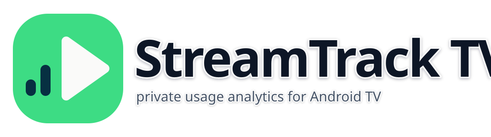
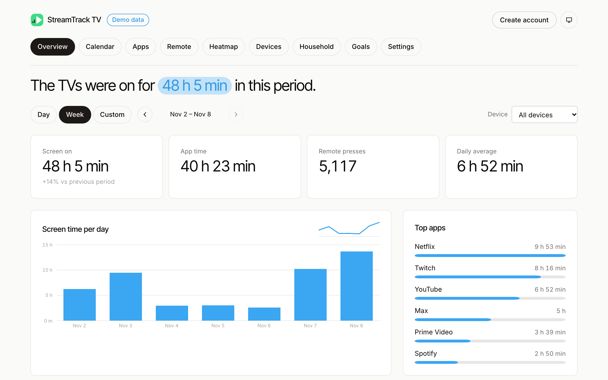
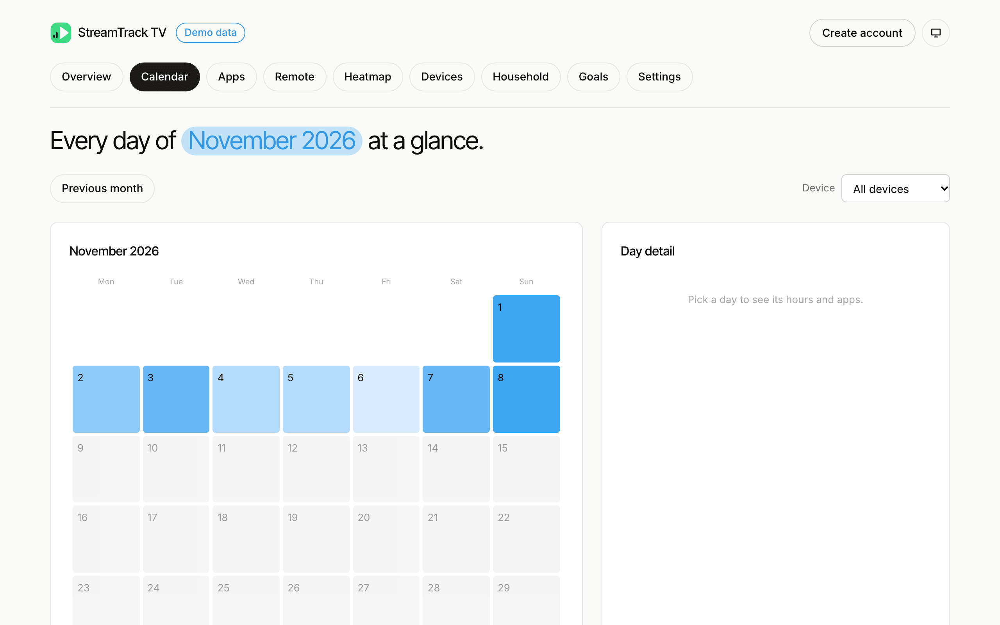

<p align="center">
  
</p>

# StreamTrack TV

[](https://www.npmjs.com/package/streamtrack-tv)
[](https://github.com/jantursky/StreamTrackTV/actions/workflows/ci.yml)
[](https://www.npmjs.com/package/streamtrack-tv)
[](LICENSE)
[](https://codecov.io/gh/jantursky/StreamTrackTV)

[Docs](https://streamtrack-tv-docs.vercel.app) · [Demo](https://streamtrack-tv.vercel.app/demo) · [npm](https://www.npmjs.com/package/streamtrack-tv) · [Changelog](CHANGELOG.md)

StreamTrack TV shows you how your Android TV is really used. An app on the TV counts screen-on time, per-app foreground time and remote key presses. A dashboard that runs in your own Vercel and Supabase accounts turns that into daily, weekly and custom-range views. Nothing goes to a third party, and the app never records which keys you press or what is on screen.

<a href="https://streamtrack-tv.vercel.app/demo">
  <picture>
    <source media="(prefers-color-scheme: dark)" srcset=".github/assets/overview-dark.png">
    
  </picture>
</a>

## What you get

- The TV app (Kotlin, Compose for TV) counts remote presses by class (D-pad, OK, Back, Home, media, volume), reads foreground app time from usage stats, tracks screen-on time and keeps hourly buckets in a local Room database. It works offline and syncs on a schedule you set, from 15 minutes to 24 hours.
- A privacy screen on the TV shows the exact JSON the next sync will send, and the list of what is never collected.
- The dashboard (Next.js on Vercel, Postgres and Auth on Supabase) has an overview, calendar with compare, apps and categories, remote usage, hour-by-weekday heatmap, devices, household members, goals and limits, read-only share links, a weekly email digest, export and delete.
- Demo mode uses seeded data and needs no sign-in, so you can look around before deploying: [streamtrack-tv.vercel.app/demo](https://streamtrack-tv.vercel.app/demo).
- `streamtrack-tv` on npm holds the sync and pairing schemas as zod validators and TypeScript types. The dashboard uses it, and a test checks the Android contract fixtures against it.

<a href="https://streamtrack-tv.vercel.app/demo/calendar">
  <picture>
    <source media="(prefers-color-scheme: dark)" srcset=".github/assets/calendar-dark.png">
    
  </picture>
</a>

## Quick start

1. Deploy the dashboard. The button copies the repository to your GitHub account, creates the Vercel project and connects a Supabase project. The first build applies the database migrations. Details and the Supabase Auth settings are in [`apps/web/DEPLOY.md`](apps/web/DEPLOY.md).

   [](https://vercel.com/new/clone?repository-url=https%3A%2F%2Fgithub.com%2Fjantursky%2FStreamTrackTV&root-directory=apps%2Fweb&project-name=streamtrack-tv&repository-name=streamtrack-tv&integration-ids=oac_VqOgBHqhEoFTPzGkPd7L0iH6&env=CRON_SECRET,NEXT_PUBLIC_SITE_URL&envDescription=CRON_SECRET%20protects%20the%20scheduled%20jobs.%20NEXT_PUBLIC_SITE_URL%20is%20the%20public%20origin%20used%20in%20emails%20and%20share%20links.&envLink=https%3A%2F%2Fgithub.com%2Fjantursky%2FStreamTrackTV%2Fblob%2Fmain%2Fapps%2Fweb%2F.env.example)

2. Install the APK from the [latest release](https://github.com/jantursky/StreamTrackTV/releases/latest) on your TV, with `adb install StreamTrackTV-<version>.apk` or the Downloader app. Check the `.sha256` file next to it first. The app is a signed APK outside Google Play because it needs the accessibility service.
3. Open the app, enter your dashboard URL, and note the code and QR it shows.
4. Sign in to the dashboard, open `/pair`, and enter the code. The TV picks up its device token a few seconds later.
5. Grant usage access and enable the accessibility service when the checklist asks. Data shows up after the next sync.

To run only the dashboard with demo data, set `DEMO_ONLY=1` and no Supabase variables.

## Use the schema package

The package is what the TV sends and what the server accepts. Use it if you write your own client or backend.

```ts
import { SCHEMA_VERSION, syncPayloadSchema } from 'streamtrack-tv'

const payload = syncPayloadSchema.parse({
  schemaVersion: SCHEMA_VERSION,
  sentAt: '2026-11-08T20:00:00+01:00',
  timezone: 'Europe/Bratislava',
  usage: [{ day: '2026-11-08', hour: 19, packageName: 'com.netflix.ninja', foregroundMs: 1_800_000 }],
  keys: [{ day: '2026-11-08', hour: 19, keyClass: 'dpad', count: 42 }],
  screen: [{ day: '2026-11-08', hour: 19, screenOnMs: 2_400_000 }],
})
```

```sh
npm install streamtrack-tv
```

A raw key code is not a valid `keyClass`, so the server rejects it. The full API is in [`apps/web/API.md`](apps/web/API.md).

## How it works

1. `android/collector` counts key presses through an accessibility service (`KeyPressService.kt`) that maps each key to a class in `KeyClassifier.kt`, and reads app events from `UsageStatsManager` (`UsageCollector.kt`).
2. `android/core` splits time at hour boundaries, so a session over midnight or a daylight-saving change lands in the right bucket, and `android/data` stores the buckets in Room.
3. `android/sync` (`SyncWorker.kt`) uploads changed buckets with WorkManager to `POST /api/v1/sync` as absolute values, so a retry never double counts.
4. `apps/web/src/app/api/v1/sync/route.ts` checks the device token, validates the body with `streamtrack-tv`, applies a per-device rate limit and upserts the rows in Postgres.
5. `supabase/migrations` defines the tables. Row level security means a signed-in user only reads their own rows.
6. `apps/web/src/views` renders the dashboard from those rows. In demo mode the same views read a seeded generator instead of the database.

## Prior art

- [ActivityWatch](https://activitywatch.net) is a mature open-source time tracker with an Android app. It stores data locally and targets phones and desktops, not a TV with a remote.
- Phone screen-time apps such as [Screen Time](https://gitlab.com/Atharok/ScreenTime) (F-Droid) and [markusfisch/ScreenTime](https://github.com/markusfisch/ScreenTime) read usage stats the same way. They don't count remote key presses, sync to a server or run a dashboard.
- [TVUsage](https://www.producthunt.com/products/tvusage-digital-wellbeing-for-android-tv) and similar Play Store apps add limits and usage reports on Android TV. They are closed source and don't give you a dashboard you host yourself.
- Google's Digital Wellbeing is built for phones; I found no sign of an equivalent on Android TV.

StreamTrack TV adds a TV-side collector that counts remote presses, a server you host and a dashboard, and limits what it collects to what the privacy screen shows.

## Support

- TV app: Android TV 8.0 (API 26) or newer, with a remote or D-pad. It needs usage access and the accessibility service.
- Dashboard: current Chrome, Firefox, Safari and Edge, desktop and phone.
- Server: Node 22 or newer on Vercel, and a Supabase project (Postgres 15 or newer).
- Schema package: Node 20 or newer, ESM only.

## Repository

| Path               | What                                 |
| ------------------ | ------------------------------------ |
| `android/`         | TV app, Gradle multi-module project  |
| `apps/web/`        | Dashboard and API                    |
| `apps/docs/`       | Documentation site                   |
| `packages/schema/` | The `streamtrack-tv` npm package     |
| `supabase/`        | SQL migrations                       |
| `design/`          | Design system and architecture notes |

See [CONTRIBUTING.md](CONTRIBUTING.md) to work on it, and [SECURITY.md](SECURITY.md) for what the app collects and how to report a problem.

## License

[MIT](LICENSE)
