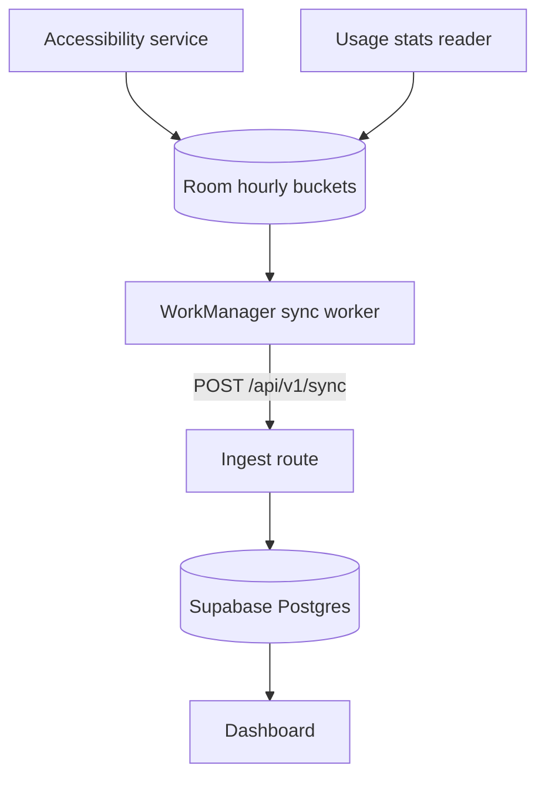
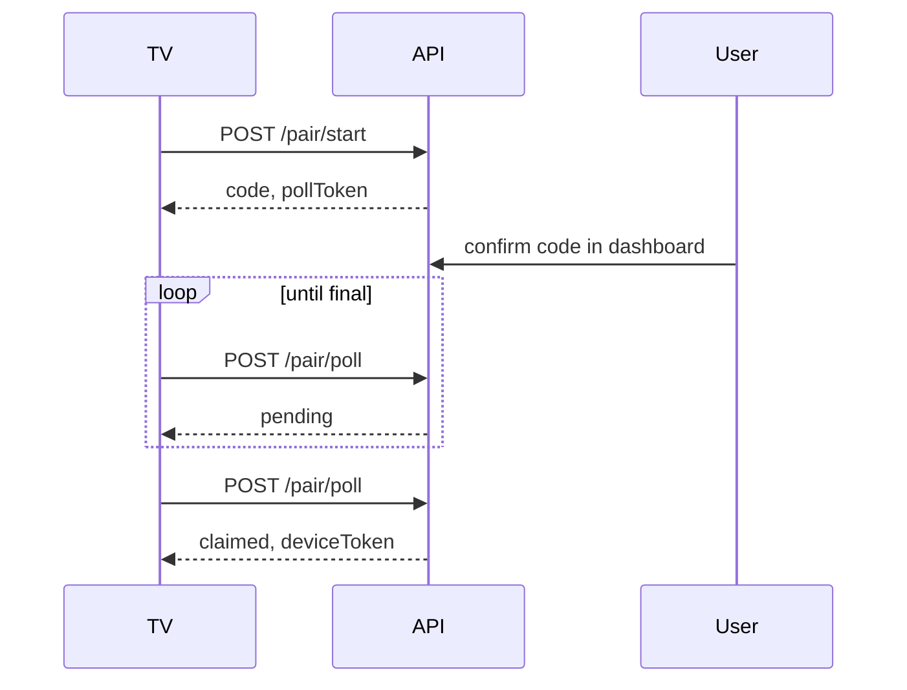

## Repository layout

```text
android/              Kotlin TV app (Compose for TV, Room, WorkManager, Ktor client)
apps/web/             Next.js dashboard and ingest API
apps/docs/            This site
packages/schema/      Zod schemas and types for the sync payload
supabase/migrations/  SQL schema and row level security policies
scripts/              Samples check, screenshots, contract check
```

## Android app

| Module      | Role                                                                                             |
| ----------- | ------------------------------------------------------------------------------------------------ |
| `app`       | Application, activity, wiring, manifest and release config                                       |
| `ui`        | Compose for TV screens and view models                                                           |
| `sync`      | Ktor client for `/api/v1`, sync engine, WorkManager worker, pairing flow                         |
| `collector` | Accessibility key counter, usage stats reader, boot receiver, permission checks                  |
| `data`      | Room (hourly buckets with sent flags, app labels), DataStore settings, encrypted token           |
| `core`      | Pure Kotlin: models, hour splitting, aggregation, goals, wire DTOs that mirror `packages/schema` |

The app targets Android 8.0 (API 26) and newer and is built against API 37. App usage comes from `UsageStatsManager` events, converted to sessions per package. Screen-on time comes from interactive and non-interactive events. Key presses come from an accessibility service that only filters key events.

## Web app

Next.js with the App Router, Tailwind v4 and Supabase Auth. Server components read data through the user's session, so row level security applies to every read. The Supabase secret key is used only in the device API, pairing, the share page, the cron routes and account deletion.

## Data flow



Pairing runs beside this flow:



## Data model

| Table               | Content                                    |
| ------------------- | ------------------------------------------ |
| `profiles`          | The user                                   |
| `household_members` | Optional people profiles                   |
| `devices`           | Name, token hash, last seen, member        |
| `usage_buckets`     | Device, day, hour, package, foreground ms  |
| `key_buckets`       | Device, day, hour, key class, count        |
| `screen_buckets`    | Device, day, hour, screen-on ms            |
| `apps`              | Package, label, category override          |
| `goals`             | Scope, metric, limit, period               |
| `pairing_codes`     | Code hash, expiry, device name, claimed by |

The buckets are unique per device and bucket key, which is what makes sync idempotent.

## The schema package

`streamtrack-tv` exports the Zod schemas, the inferred types, `LIMITS`, `KEY_CLASSES`, `SCHEMA_VERSION` and `bucketKey()`. The web app imports it. The Android DTOs are checked against its fixtures in a contract test. See the [API reference](/api).
